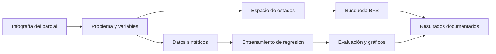
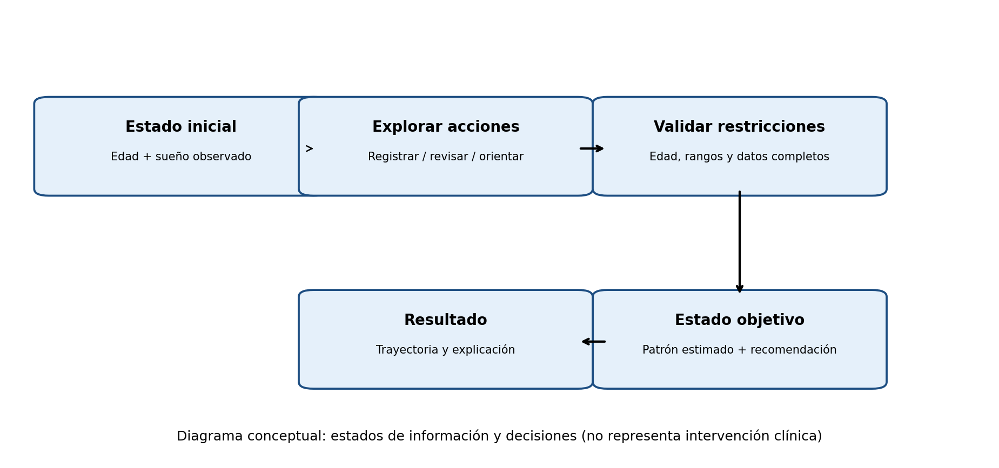
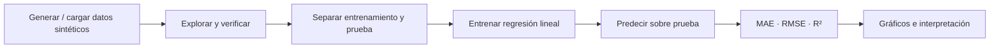

<div align="center">

# 🌙 SleepCycle ML

### El sueño en los primeros meses de vida

**Del razonamiento simbólico a la predicción con Machine Learning**

*Universidad Peruana Cayetano Heredia · Machine Learning · Caso C: sueño en los recién nacidos*

[](https://www.python.org/)
[](https://colab.research.google.com/)
[](https://scikit-learn.org/)
[](https://github.com/Cabezob341/Machine_Learning)

**📊 180 registros sintéticos** · **🧭 Búsqueda BFS** · **📈 Regresión lineal múltiple** · **🧪 Evaluación reproducible**

[🚀 Ejecutar razonamiento en Colab](https://colab.research.google.com/github/Cabezob341/Machine_Learning/blob/main/notebooks/01_Razonamiento_Busqueda.ipynb) · [📉 Ejecutar regresión en Colab](https://colab.research.google.com/github/Cabezob341/Machine_Learning/blob/main/notebooks/02_Regresion_Sueno.ipynb) · [📂 Ver notebooks](notebooks/) · [📖 Guía de entrega](documentacion/PASOS_MANUALES.md)

</div>

> [!IMPORTANT]
> **Proyecto académico demostrativo.** Los 180 registros del modelo se generaron de forma **100 % sintética**. Las cifras presentadas en la infografía son referencias agregadas y **no** un dataset clínico individual. Este trabajo **no diagnostica, no prescribe tratamientos y no permite inferir efectos causales sobre el sueño infantil**.

---

## 🧭 Explora el proyecto

| | Sección | ¿Qué encontrarás? |
|:--:|---|---|
| 🎯 | [01 · Caso y problema](#-01--presentación-del-caso-y-problema--5-puntos) | Contexto, pregunta, objetivos y variables |
| 🧩 | [02 · Espacio de estados](#-02--espacio-de-estados--5-puntos) | Modelo formal, reglas, transiciones y diagrama |
| 🧠 | [03 · Razonamiento y búsqueda](#-03--pipeline-de-razonamiento-y-búsqueda--5-puntos) | Exploración BFS y resultado |
| 📈 | [04 · Predicción y visualización](#-04--pipeline-de-predicción-y-visualización--5-puntos) | Modelo, métricas e interpretación |
| 📁 | [Estructura del repositorio](#-estructura-del-repositorio) | Archivos y carpetas |
| 📚 | [Fuentes y límites](#-fuentes-y-referencias) | Material utilizado y advertencias |

## ✨ Vista general

Este proyecto integra **dos maneras complementarias de abordar un problema con IA**:

1. **Razonamiento basado en estados:** organizar la secuencia de registro, validación y documentación mediante una búsqueda en anchura (BFS).
2. **Aprendizaje automático supervisado:** estimar una **duración numérica de ciclos de sueño (minutos)** a partir de variables de entrada, usando regresión lineal múltiple.



### 📋 Relación con la rúbrica

| Bloque evaluado | Entregable | Puntaje |
|---|---|:---:|
| Presentación del caso y problema | Planteamiento fundamentado en el caso | **5** |
| Espacio de estados | Estados, acciones, restricciones y visualización | **5** |
| Razonamiento, búsqueda y resultados | Notebook Python de exploración BFS | **5** |
| Modelo de predicción y visualización | Notebook de regresión, evaluación y gráficos | **5** |
| **Total** | **Cuatro componentes integrados** | **20** |

> [!NOTE]
> El archivo de evaluación adjunto se denomina **“Challenge 1 (Individual): Pipeline de Machine Learning”**, mientras que en la conversación se lo ha llamado “Challenge 2”. La organización de este repositorio sigue **los cuatro apartados de la rúbrica proporcionada**, sin asumir una rúbrica distinta.

---

## 🎯 01 · Presentación del caso y problema 

### 🍼 Punto de partida: la infografía del examen

La infografía *El sueño en los primeros meses de vida* informa sobre un estudio de 2025 con **152 bebés**, **100 padres** y **más de 35 000 horas de sueño** registradas mediante actigrafía; señala observaciones a los **3, 6 y 12 meses**.

En su representación divulgativa de la duración de los ciclos de sueño se aprecian valores aproximados de **50 min a los 3 meses**, **58 min a los 6 meses** y **62 min a los 12 meses**. También menciona, como referencia general para las primeras semanas, unas **16 horas diarias de sueño fragmentado**.

**Estas cifras son información resumida de la fuente; no equivalen a registros individuales descargables.**

### ❓ Problema de investigación

La evolución del sueño durante los primeros meses de vida es variable. Al combinar edad, despertares y otros registros, resulta necesario **ordenar la información, comprobar su integridad y explorar si es posible estimar la duración del ciclo de sueño**.

**Pregunta central:**

> ¿Es posible estimar la duración promedio del ciclo de sueño, en minutos, a partir de variables observables del bebé mediante un modelo de aprendizaje supervisado entrenado con **datos sintéticos inspirados en el caso**?

### 🎓 Objetivos

**Objetivo general:** construir un pipeline reproducible para representar el problema, explorar estados válidos y entrenar/evaluar un modelo de regresión que estime la duración del ciclo de sueño.

<details>
<summary><strong>📌 Ver los cuatro objetivos específicos</strong></summary>

1. Identificar estados, operadores, restricciones y variables vinculadas con el proceso de registro.
2. Implementar **búsqueda en anchura (BFS)** hasta encontrar el estado objetivo.
3. Generar, revisar y documentar un conjunto de datos sintéticos, sin confundirlo con los datos reales de la infografía.
4. Entrenar una regresión lineal con partición de entrenamiento/prueba y evaluarla usando **MAE, RMSE y R²** más visualizaciones.

</details>

### 🤖 ¿Por qué Machine Learning?

La duración del ciclo se expresa en **minutos**, una cantidad numérica; por ello corresponde una tarea de **regresión**, no de clasificación. Usamos **aprendizaje supervisado**: las variables predictoras son `X` y la duración conocida en cada fila sintética es `y`. La **regresión lineal múltiple** sirve como punto de partida por su sencillez, reproducibilidad e interpretabilidad, conforme a los temas tratados en las sesiones 5, 6 y 7.

### 🧾 Diccionario de variables

| Variable | Naturaleza | Rol en el modelo | Detalle |
|---|---|---|---|
| `edad_meses` | Entero (0–12) | Predictora | Edad registrada en meses |
| `lactancia` | Binaria (0/1) | Predictora | Indicador ficticio; no implica causalidad |
| `actividad_motora_0_10` | Numérica (0–10) | Predictora | Escala simulada de actividad |
| `despertares_noche` | Entero (1–9) | Predictora | Despertares nocturnos simulados |
| **`duracion_ciclo_min`** | **Numérica continua** | **🎯 Objetivo (`y`)** | Duración del ciclo en minutos |
| `horas_sueno_dia` | Numérica (horas) | Contextual | No entra como predictor |

---

## 🧩 02 · Espacio de estados 

Se representa el avance de un **proceso de gestión de información**, no las etapas clínicas ni fisiológicas del bebé.

### Modelo formal

\[
P=(S,A,T,s_0,G,C)
\]

| Elemento | Definición |
|---|---|
| **S** | Tupla booleana `(edad_registrada, sueno_registrado, variables_revisadas, orientacion_documentada)` |
| **A** | `registrar_edad`, `registrar_sueno`, `validar_variables`, `documentar_orientacion` |
| **T** | Transición válida que activa el indicador correspondiente si se cumplen sus precondiciones |
| **s₀** | `(False, False, False, False)` — estado inicial |
| **G** | `(True, True, True, True)` — objetivo: registro completo y documentado |
| **C** | Restricciones sobre rangos, orden de ejecución y consistencia |

### 🔐 Reglas y restricciones

- Edad entre **0 y 12 meses**; duración del ciclo **positiva**; horas de sueño dentro de **0–24**.
- Para **validar**, primero deben estar registrados la edad y el sueño.
- Para **documentar la orientación**, primero deben estar validadas las variables.
- En esta búsqueda simplificada **no se revierten acciones completadas**.
- Los rangos anteriores son **restricciones computacionales del ejercicio, no puntos de corte médicos**.

### 🗺️ Diagrama de estados



**Una trayectoria válida hasta la meta**:

```text
(0,0,0,0)
    │ registrar_edad
    ▼
(1,0,0,0)
    │ registrar_sueno
    ▼
(1,1,0,0)
    │ validar_variables
    ▼
(1,1,1,0)
    │ documentar_orientacion
    ▼
(1,1,1,1)   ✓ ESTADO OBJETIVO
```

BFS inspecciona estados por niveles y encuentra un camino de **cuatro acciones**. Es una solución mínima en número de operaciones porque las cuatro banderas deben activarse y cada acción activa, como máximo, una.

---

## 🧠 03 · Pipeline de razonamiento y búsqueda

<div align="center">

[](https://colab.research.google.com/github/Cabezob341/Machine_Learning/blob/main/notebooks/01_Razonamiento_Busqueda.ipynb)

</div>

📓 **Archivo:** [`notebooks/01_Razonamiento_Busqueda.ipynb`](notebooks/01_Razonamiento_Busqueda.ipynb)

El notebook aborda las etapas **Problema → Espacio de estados → Exploración → Búsqueda → Resultado**, con definición de operaciones, función de sucesores, estados visitados, control de restricciones, recuperación de trayectoria y visualización.

<details>
<summary><strong>🔎 ¿Qué hace el algoritmo BFS?</strong></summary>

1. Inserta el estado inicial en una cola.
2. Extrae el siguiente estado pendiente y comprueba si es la meta.
3. Genera sucesores que respeten las precondiciones.
4. Marca estados visitados para evitar repeticiones.
5. Si alcanza la meta, reconstruye el recorrido realizado.

**Resultado esperado del caso:** una ruta de **4 acciones** que llega a `(True, True, True, True)`. La cantidad total de estados visitados depende de la implementación y del orden de expansión.

</details>

---

## 📈 04 · Pipeline de predicción y visualización 

<div align="center">

[](https://colab.research.google.com/github/Cabezob341/Machine_Learning/blob/main/notebooks/02_Regresion_Sueno.ipynb)

</div>

📓 **Archivo:** [`notebooks/02_Regresion_Sueno.ipynb`](notebooks/02_Regresion_Sueno.ipynb)

**Flujo implementado:**



### 🧮 Modelo seleccionado

**Regresión lineal múltiple**:

```text
Duración estimada (min) = β₀
                        + β₁ × edad_meses
                        + β₂ × lactancia
                        + β₃ × actividad_motora_0_10
                        + β₄ × despertares_noche
                        + error
```

Se trata de un modelo **base e interpretable**. Los coeficientes solo describen relaciones aprendidas **en el conjunto sintético**; no representan efectos biológicos ni permiten interpretar la lactancia como una causa.

### 📊 Evaluación y visualizaciones

| Indicador | ¿Qué mide? | Lectura |
|---|---|---|
| **MAE** | Error absoluto medio | Minutos de desviación promedio |
| **RMSE** | Raíz del error cuadrático medio | Penaliza más los errores grandes |
| **R²** | Coeficiente de determinación | Proporción de variabilidad explicada en la prueba |

El notebook muestra **edad frente a duración de ciclo**, **valores reales frente a predichos** y **gráfico de residuos**, además de una predicción demostrativa.

<details>
<summary><strong>🧪 Ver resultados de la ejecución de ejemplo</strong></summary>

| Métrica en datos sintéticos | Valor aproximado |
|---|---:|
| MAE | **2.81 min** |
| RMSE | **3.47 min** |
| R² | **0.731** |
| Ejemplo de predicción a los 6 meses (con otras variables fijadas en el notebook) | **53.2 min** |

Estos números se refieren a una **ejecución de ejemplo**, no a una validación externa. Para confirmar los valores de tu versión, ejecuta todas las celdas del notebook y revisa sus salidas; pueden variar si se modifica el código, los parámetros o los datos.

</details>

### ⚖️ Límites del experimento

- Los datos se **generan**, no provienen de historias clínicas ni de mediciones individuales del estudio.
- Un buen ajuste sobre datos sintéticos **no garantiza generalización** a bebés reales.
- Una futura evaluación con datos reales requeriría autorización, revisión de sesgos, protección de datos y validación independiente; también podría comparar alternativas no lineales.

---

## 📁 Estructura del repositorio

```text
Machine_Learning/
├── README.md
├── requirements.txt
├── notebooks/
│   ├── 01_Razonamiento_Busqueda.ipynb
│   └── 02_Regresion_Sueno.ipynb
├── datos/
│   ├── sueno_sintetico.csv
│   └── fuentes_referenciales.csv
├── imagenes/
│   └── diagrama_estados.png
└── documentacion/
    └── PASOS_MANUALES.md
```

<details>
<summary><strong>✅ Lista de comprobación antes de entregar</strong></summary>

- [ ] Se ven correctamente el README y el diagrama en GitHub.
- [ ] Los enlaces de ambos notebooks abren Google Colab.
- [ ] El Notebook 01 muestra la solución BFS y los estados explorados.
- [ ] El Notebook 02 muestra métricas y gráficos sin errores.
- [ ] Los datos están identificados explícitamente como sintéticos.
- [ ] Los notebooks ejecutados están guardados en el repositorio.
- [ ] El repositorio es accesible al docente.

Consulta también la [guía detallada de pasos manuales](documentacion/PASOS_MANUALES.md).

</details>

---

## 📚 Fuentes y referencias

1. **Caso de examen:** infografía *El sueño en los primeros meses de vida*, fotografía proporcionada en el parcial. Se emplean sus referencias agregadas y se distingue su contenido de la simulación.
2. **UPCH, sesión 5:** *Tipos de Aprendizaje* (supervisado y otras modalidades).
3. **UPCH, sesión 6:** *Clasificación vs Regresión y Clustering vs Reducción*.
4. **UPCH, sesión 7:** *Regresión Lineal, Regresión No Lineal y Regresión Logística*.
5. **Hoja de evaluación:** *Challenge 1 (Individual): Pipeline de Machine Learning*, preparada el **06/10/2026**.

> [!CAUTION]
> **Uso educativo exclusivamente.** No debe utilizarse el modelo para diagnóstico, evaluación médica ni recomendaciones clínicas. Los resultados cuantitativos describen una simulación y **no equivalen a evidencia médica**.

---

<div align="center">

### 🌌 Aprender de los datos. Razonar con claridad. Comunicar con responsabilidad.

**Machine Learning · UPCH · 2026**

[⬆ Volver al inicio](#-sleepcycle-ml) · [🚀 Notebook 01](https://colab.research.google.com/github/Cabezob341/Machine_Learning/blob/main/notebooks/01_Razonamiento_Busqueda.ipynb) · [📈 Notebook 02](https://colab.research.google.com/github/Cabezob341/Machine_Learning/blob/main/notebooks/02_Regresion_Sueno.ipynb)

</div>
